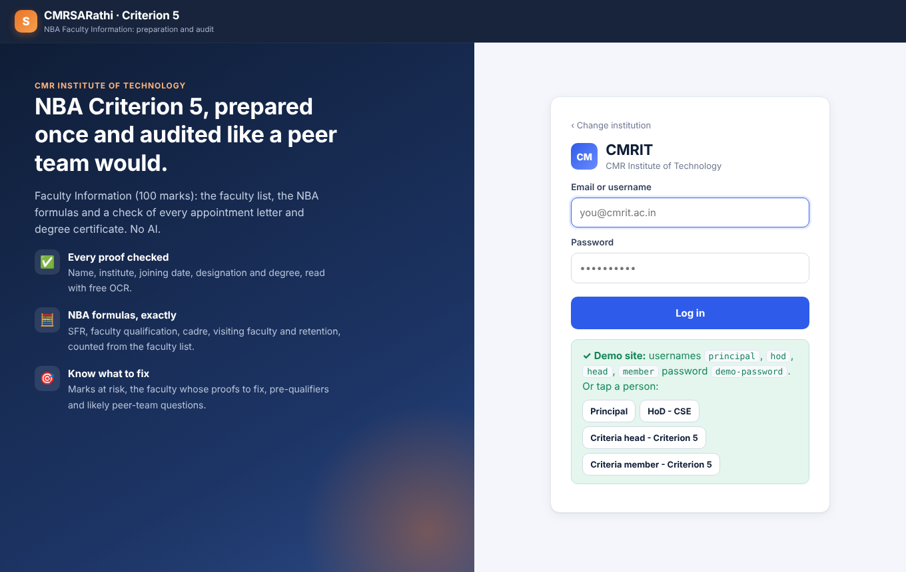
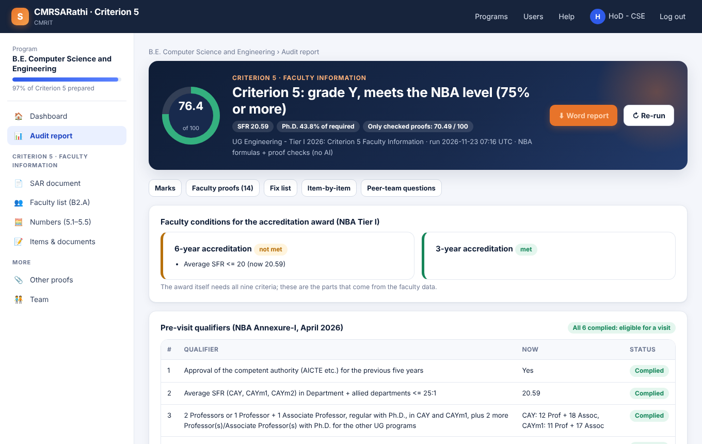
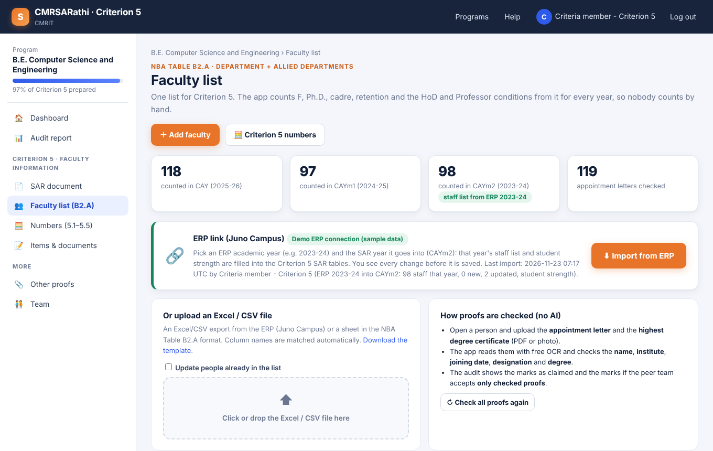
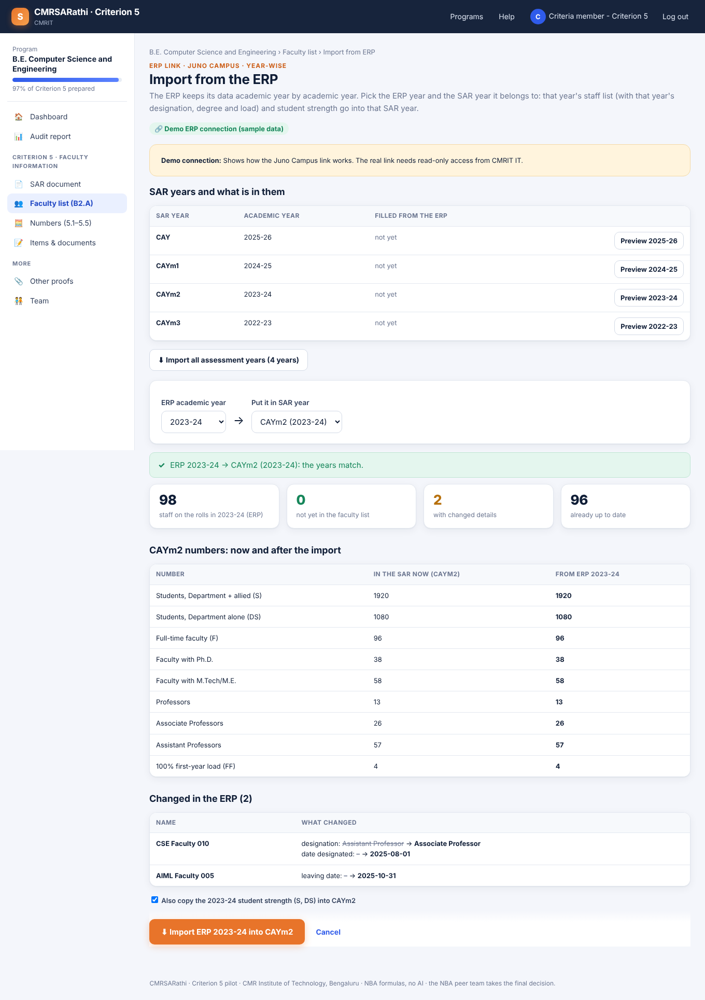
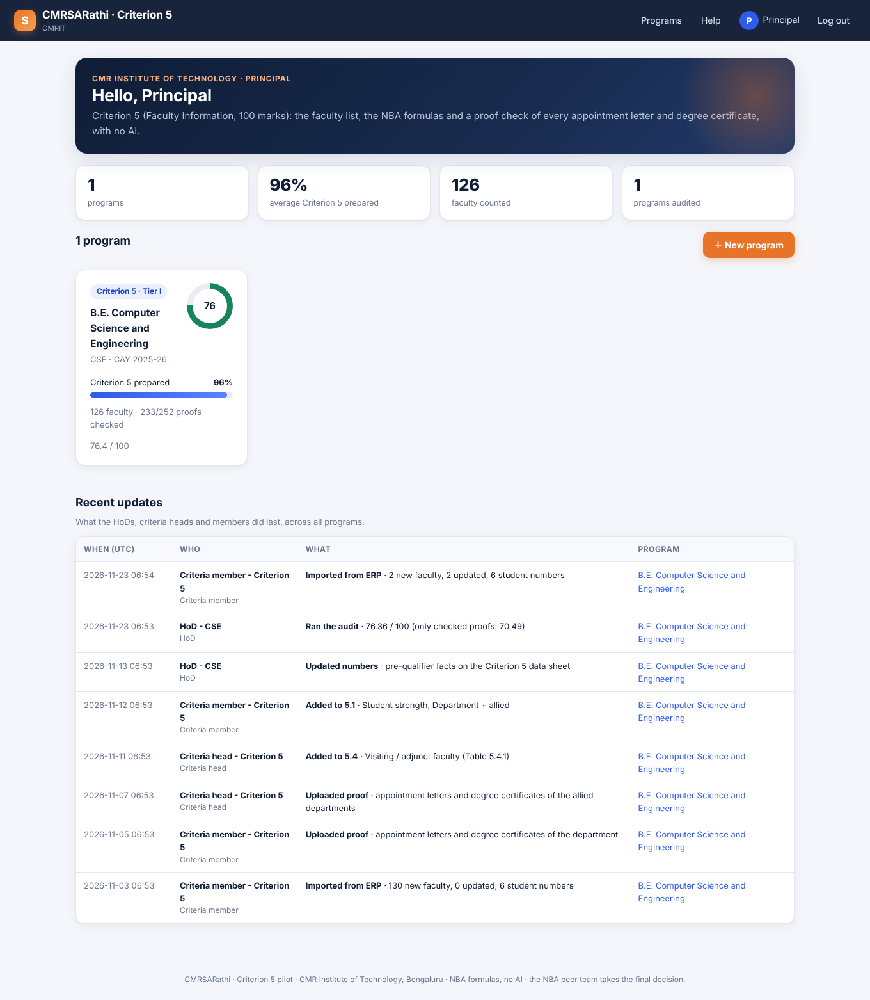
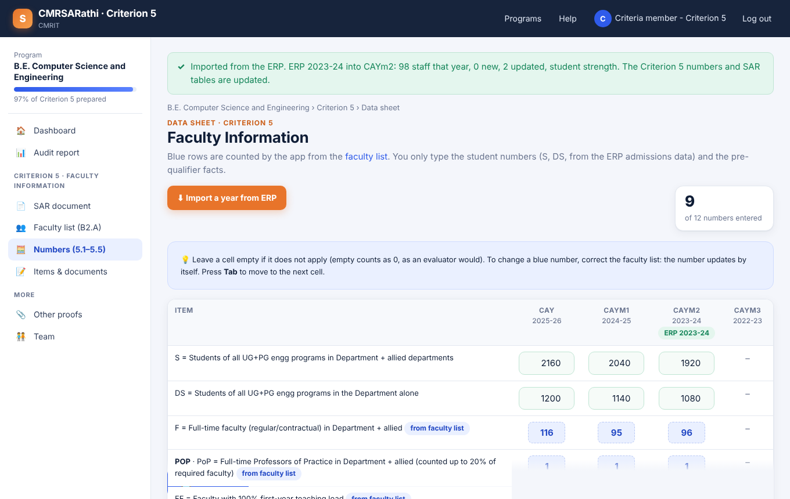
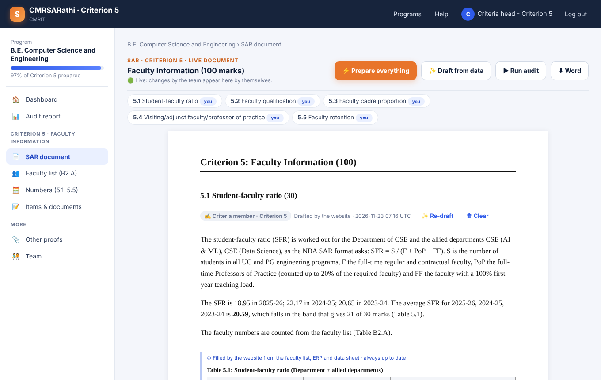
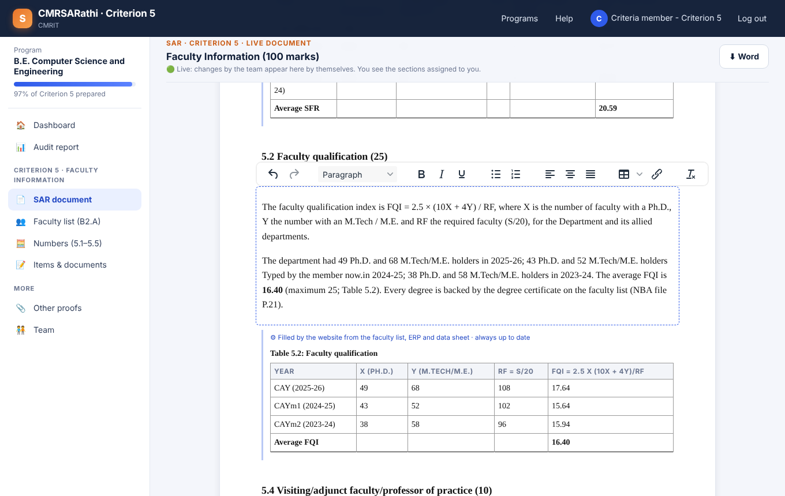

# CMRSARathi · Criterion 5

**NBA Criterion 5 (Faculty Information, 100 marks): prepared once, audited like an NBA peer team, with no AI.**

This is the one-criterion pilot of [CMRSARathi](https://github.com/Zhussain13/CMRSARathi), the CMRIT Mega Project
(Dept. of CSE, CMR Institute of Technology, Bengaluru) for NBA SAR preparation and audit. The committee asked for one
criterion working end to end before the full nine; Criterion 5 was chosen because every mark comes from an NBA formula,
so the free Gemini quota is never touched: **no AI tokens are used at all**.

Same design, same logins and roles as CMRSARathi, cut down to Criterion 5 and built around the faculty list.

## What it does

| Step | What the app does |
|---|---|
| 1. Faculty list (NBA Table B2.A) | **Import from ERP, year-wise**: the ERP keeps data academic year by academic year. Pick the ERP year (e.g. 2023-24) and the SAR year it goes into (e.g. CAYm2): that year's staff list (who was on the rolls, with that year's designation, degree and load) and that year's student strength are filled into that SAR year. The app suggests the matching SAR year and warns if the years do not match; "Import all assessment years" does CAY to CAYm3 in one go. Every new person, changed detail and number is shown before it is saved. Or upload an Excel/CSV export, or add people one by one. Department and allied departments together. |
| 2. Counting | For CAY, CAYm1 and CAYm2 it counts F, PoP, FF, Ph.D., M.Tech, Professors / Associate / Assistant Professors, retention bands A-E, the HoD and Professor conditions. Promotions and Ph.D. award dates are respected year by year. Nobody counts by hand. |
| 3. Numbers | Only the student strength (S, DS, from the ERP admissions data) and three pre-qualifier facts are typed in. Visiting-faculty hours are added up from SAR Table 5.4.1. |
| 4. Proof check | Each person's appointment letter and degree certificate (PDF or phone photo) is read with free OCR (pdfplumber / Tesseract) and checked: name, institute, joining date, designation, degree, university, duplicate files. Every failed check says why. |
| 5. Audit | Marks for 5.1-5.5 with the working (NBA formulas, tested against NBA's own worked examples), grade Y/C/W/D, the marks **if the peer team accepts only checked proofs**, the faculty whose proofs to fix, NBA pre-visit qualifiers, faculty conditions for 3-year / 6-year accreditation, fix list and likely peer-team questions. |
| 6. One shared record | What a criteria member adds (ERP import, faculty, proofs, numbers) is saved in one place, so the criteria head, HoD and principal see it at once. "Recent updates" on the dashboard (and the principal's home page) shows who did what and when; each faculty record shows its source (ERP / file / typed) and who changed it last. |
| 7. SAR document (live, like Google Docs) | **The website writes the SAR**: one click on "Draft from data" writes the text of every section (5.1-5.5) with the department's own numbers, and the NBA tables (5.1 to 5.5, 5.4.1) are built from the data every time, so they are never out of date. People only polish the text, typing straight on a clean Word-like page that saves itself. Every change appears for the others within seconds. A section a person has edited is never overwritten unless the head or HoD presses "Re-draft". |
| 8. One click | **"Prepare everything"** (HoD, criteria head): imports every assessment year from the ERP, checks all proofs again, drafts the SAR and runs the audit. |
| 9. Word files | Audit report (.docx) and the Criterion 5 SAR draft (.docx) with the data tables, Table B2.A, the proof list and the evidence index. |

### Formulas (NBA SAR format, Tier I, April 2026)

| Item | Marks | Formula |
|---|---|---|
| 5.1 Student-faculty ratio | 30 | SFR = S / (F + PoP − FF), average of 3 years; bands <15 → 30 … <25 → 15 |
| 5.2 Faculty qualification | 25 | FQI = 2.5 × (10X + 4Y) / RF, RF = S/20 |
| 5.3 Faculty cadre | 25 | (AF1/RF1 + 0.6·AF2/RF2 + 0.4·AF3/RF3) × 12.5, RF1:RF2:RF3 = 1:2:6 |
| 5.4 Visiting / adjunct / PoP | 10 | 1 for provision + 3 per year with ≥ 50 hours |
| 5.5 Faculty retention | 10 | ((B + 2C + 3D + 4E) / RF) × 2.5, RF = DS/20 |

Counting rules the IQAC should confirm (constants in `app/roster.py`): a person counts in a year if on the rolls for at
least 6 months of it; designation and degree are taken as on 1 January of the year; PoP counted up to 20% of required
faculty (NBA Annexure-I).

## ERP link

`ERP_MODE` (environment variable):

| Mode | What it does |
|---|---|
| `demo` (default) | Demo connection with sample year-wise data (2021-22 to 2025-26) shaped like a Juno Campus export: 2 new joinees, 1 person who left, 1 promotion since the last import. Clearly labelled as sample data on screen. |
| `database` | Read-only connection to the ERP database (`ERP_DB_URL`). Needs a read-only account and the table structure from CMRIT IT; until the tables are mapped it says "not connected". |
| `off` | No ERP button. |

All modes return, for one academic year, the same record shape as the faculty list plus that year's details, so the
comparison, the import and the proof re-checks are the same (`app/erp.py`). An imported year is stored per SAR year
(`faculty_year`, `erp_imports`); for that year the ERP's staff list decides who counts and as what. Years without an
ERP import use the dates in the faculty list. The Numbers page and the faculty list show "ERP 2023-24" on each year
that came from the ERP.

## Roles

| Role | Can do |
|---|---|
| Platform owner | Adds colleges and their principal login; sees no college data. |
| Principal | Sees every program and the whole SAR, live; runs the audit. Edits nothing (creates user accounts only). |
| HoD | Every operation on their program: add, edit, delete, draft, ERP import, team, assigns SAR sections; runs the audit. |
| Criteria head | The whole SAR of their criteria: add, edit, delete, re-draft, ERP import; assigns sections; runs the audit. |
| Criteria member | Types only in the SAR sections assigned to them (e.g. 5.1, 5.2, 5.4) and sees only those; data entry (faculty, numbers, proofs); deletes nothing; runs no audits. |

## Try it

Demo logins (password `demo-password`; on the login page the user name alone works):

| Role | Login |
|---|---|
| Platform owner | `owner@cmrsarathi.local` (choose "Platform owner sign-in") |
| Principal | `principal@cmrit.local` |
| HoD | `hod@cmrit.local` |
| Criteria head | `head@cmrit.local` |
| Criteria member | `member@cmrit.local` (types SAR sections 5.1, 5.2, 5.4) |

The demo has CMRIT with B.E. CSE and a **made-up** faculty list of 130 people named only by position and staff code
("CSE Faculty 001", "HoD CSE"): no real names. A few proofs are wrong on purpose (missing letter, wrong joining date,
someone else's letter, a copied file, an M.Tech certificate for a Ph.D.) so the audit has something to find.

```
pip install -r requirements.txt        # Tesseract binary needed only for scanned proofs / photos
flask --app run seed-demo              # demo data
python run.py                          # http://127.0.0.1:5000
python -m pytest -q                    # 29 tests, all must pass
```

Or: `start.bat` (Windows), `./start.sh` (Mac/Linux), GitHub Codespaces (`.devcontainer`), or Render
(New › Blueprint › this repo; `render.yaml`, free plan, demo data recreated on every start). On Render's free plan
there is no Tesseract, so only text PDFs are read; on the CMRIT server install Tesseract for scans and photos.

## Screenshots

| | |
|---|---|
|  |  |
|  |  |
|  |  |
|  |  |
|  |  |
|  |  |

## Code map

```
app/rules/criterion5_tier1_2026.yaml  marks, formulas, data fields (auto: roster = counted from the faculty list)
app/roster.py          faculty list -> year-wise Criterion 5 numbers (and the "only checked proofs" count)
app/faculty_proofs.py  appointment letter / degree certificate checks, proof status, faculty issues
app/erp.py             ERP link (demo / database / off) and the "what would change" comparison
app/sar_draft.py       the website's SAR writer: section text from the data and the NBA tables (always live)
app/views/document.py  live SAR document: section rights, autosave, live refresh, draft, one-click prepare
app/activity.py        who did what (Recent updates for the head, HoD and principal)
app/c5audit.py         the audit: engine + strict re-score + proofs + pre-qualifiers + award conditions
app/engine.py          NBA scorers (shared with CMRSARathi)
app/views/faculty.py   faculty list pages, ERP/Excel import, proof upload
app/demo.py            demo data (position names only) and sample proof PDFs
docs/nba/              the official NBA PDFs used for the rules
```

## Not done yet (honest list)

- The ERP button runs on a demo connection (sample data). The real Juno Campus link needs a read-only database account
  and the table structure from CMRIT IT; the code path (`DatabaseERP` in `app/erp.py`) is ready to be filled in.
- Counting rules marked above to be confirmed with the IQAC.
- Criteria 1-4 and 6-9 live in the main CMRSARathi app.

Estimates only: the NBA peer team takes the final decision.
