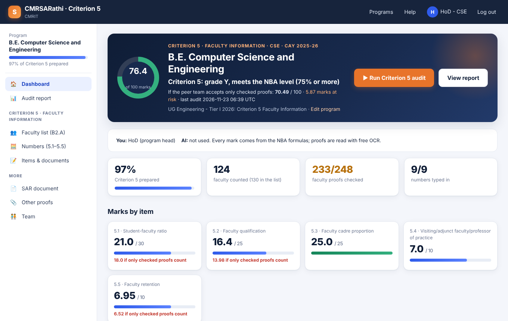
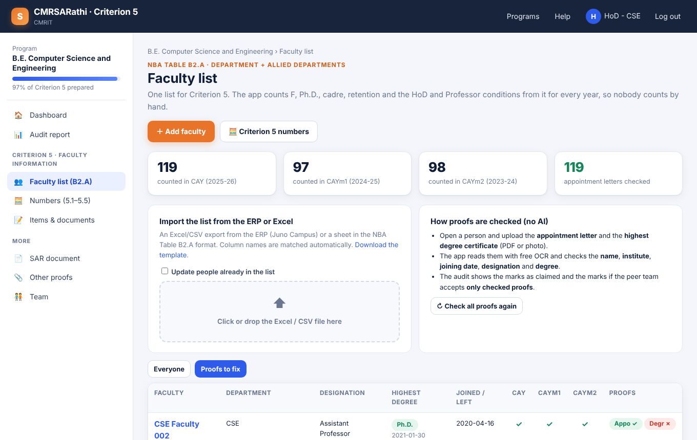
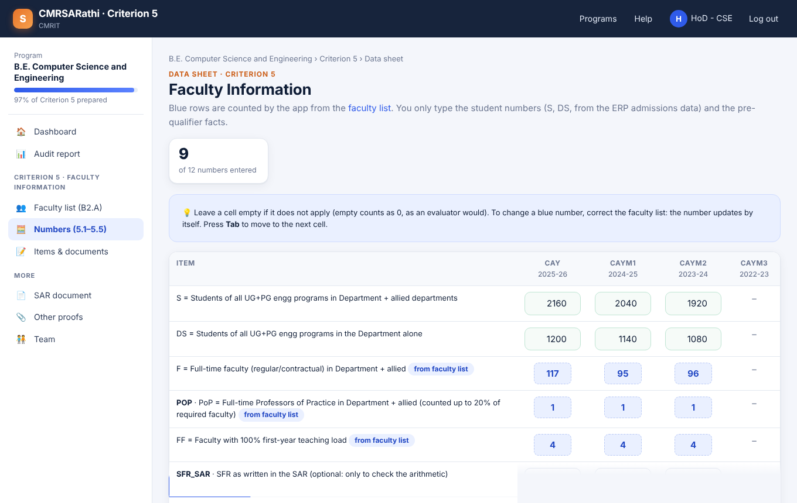
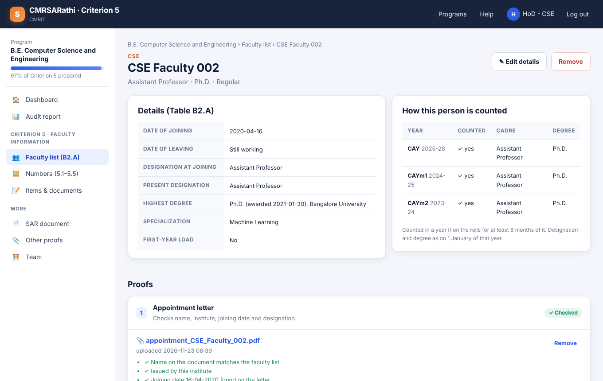

# CMRSARathi · Criterion 5

**NBA Criterion 5 (Faculty Information, 100 marks): prepared once, audited like an NBA peer team, with no AI.**

This is the one-criterion pilot of [CMRSARathi](https://github.com/Zhussain13/CMRSARathi), the CMRIT Mega Project
(Dept. of CSE, CMR Institute of Technology, Bengaluru) for NBA SAR preparation and audit. The committee asked for one
criterion working end to end before the full nine; Criterion 5 was chosen because every mark comes from an NBA formula,
so the free Gemini quota is never touched: **no AI tokens are used at all**.

Same design, same logins and roles as CMRSARathi, cut down to Criterion 5 and built around the faculty list.

## What it does

| Step | What the app does |
|---|---|
| 1. Faculty list (NBA Table B2.A) | Import an Excel/CSV export from the ERP (Juno Campus) or add people one by one. Column names are matched automatically. Department and allied departments together. |
| 2. Counting | For CAY, CAYm1 and CAYm2 it counts F, PoP, FF, Ph.D., M.Tech, Professors / Associate / Assistant Professors, retention bands A-E, the HoD and Professor conditions. Promotions and Ph.D. award dates are respected year by year. Nobody counts by hand. |
| 3. Numbers | Only the student strength (S, DS, from the ERP admissions data) and three pre-qualifier facts are typed in. Visiting-faculty hours are added up from SAR Table 5.4.1. |
| 4. Proof check | Each person's appointment letter and degree certificate (PDF or phone photo) is read with free OCR (pdfplumber / Tesseract) and checked: name, institute, joining date, designation, degree, university, duplicate files. Every failed check says why. |
| 5. Audit | Marks for 5.1-5.5 with the working (NBA formulas, tested against NBA's own worked examples), grade Y/C/W/D, the marks **if the peer team accepts only checked proofs**, the faculty whose proofs to fix, NBA pre-visit qualifiers, faculty conditions for 3-year / 6-year accreditation, fix list and likely peer-team questions. |
| 6. Word files | Audit report (.docx) and the Criterion 5 SAR draft (.docx) with the data tables, Table B2.A, the proof list and the evidence index. |

### Formulas (NBA SAR format, Tier I, April 2026)

| Item | Marks | Formula |
|---|---|---|
| 5.1 Student-faculty ratio | 30 | SFR = S / (F + PoP − FF), average of 3 years; bands <15 → 30 … <25 → 15 |
| 5.2 Faculty qualification | 25 | FQI = 2.5 × (10X + 4Y) / RF, RF = S/20 |
| 5.3 Faculty cadre | 25 | (AF1/RF1 + 0.6·AF2/RF2 + 0.4·AF3/RF3) × 12.5, RF1:RF2:RF3 = 1:2:6 |
| 5.4 Visiting / adjunct / PoP | 10 | 1 for provision + 3 per year with ≥ 50 hours |
| 5.5 Faculty retention | 10 | ((B + 2C + 3D + 4E) / RF) × 2.5, RF = DS/20 |

Counting rules the IQAC should confirm (constants in `app/roster.py`): a person counts in a year if on the rolls for at
least 6 months of it; designation and degree are taken as on 1 January of the year; PoP counted up to 20% of required
faculty (NBA Annexure-I).

## Roles

| Role | Can do |
|---|---|
| Platform owner | Adds colleges and their principal login; sees no college data. |
| Principal | Creates programs and users; sees and edits every program; runs the audit. |
| HoD | Keeps the faculty list and team of the program; edits Criterion 5; runs the audit. |
| Criteria head | Leads Criterion 5 (faculty list, numbers, proofs); runs the audit. |
| Criteria member | Adds faculty, numbers and proofs; sees the results; runs no audits. |

## Try it

Demo logins (password `demo-password`; on the login page the user name alone works):

| Role | Login |
|---|---|
| Platform owner | `owner@cmrsarathi.local` (choose "Platform owner sign-in") |
| Principal | `principal@cmrit.local` |
| HoD | `hod@cmrit.local` |
| Criteria head | `head@cmrit.local` |
| Criteria member | `member@cmrit.local` |

The demo has CMRIT with B.E. CSE and a **made-up** faculty list of 130 people named only by position and staff code
("CSE Faculty 001", "HoD CSE"): no real names. A few proofs are wrong on purpose (missing letter, wrong joining date,
someone else's letter, a copied file, an M.Tech certificate for a Ph.D.) so the audit has something to find.

```
pip install -r requirements.txt        # Tesseract binary needed only for scanned proofs / photos
flask --app run seed-demo              # demo data
python run.py                          # http://127.0.0.1:5000
python -m pytest -q                    # 24 tests, all must pass
```

Or: `start.bat` (Windows), `./start.sh` (Mac/Linux), GitHub Codespaces (`.devcontainer`), or Render
(New › Blueprint › this repo; `render.yaml`, free plan, demo data recreated on every start). On Render's free plan
there is no Tesseract, so only text PDFs are read; on the CMRIT server install Tesseract for scans and photos.

## Screenshots

| | |
|---|---|
|  |  |
|  |  |
|  |  |

## Code map

```
app/rules/criterion5_tier1_2026.yaml  marks, formulas, data fields (auto: roster = counted from the faculty list)
app/roster.py          faculty list -> year-wise Criterion 5 numbers (and the "only checked proofs" count)
app/faculty_proofs.py  appointment letter / degree certificate checks, proof status, faculty issues
app/c5audit.py         the audit: engine + strict re-score + proofs + pre-qualifiers + award conditions
app/engine.py          NBA scorers (shared with CMRSARathi)
app/views/faculty.py   faculty list pages, ERP/Excel import, proof upload
app/demo.py            demo data (position names only) and sample proof PDFs
docs/nba/              the official NBA PDFs used for the rules
```

## Not done yet (honest list)

- Direct connection to the Juno Campus ERP database: today the list comes in as an Excel/CSV export (read-only DB access
  from CMRIT IT is the next step).
- Counting rules marked above to be confirmed with the IQAC.
- Criteria 1-4 and 6-9 live in the main CMRSARathi app.

Estimates only: the NBA peer team takes the final decision.
